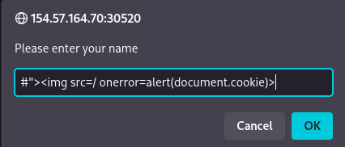
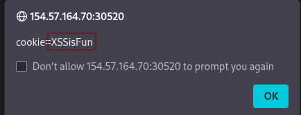

# Introduction to Web Applications

## Front End Components

### HTML

1. **What is the HTML tag used to show an image?**

answer: **``**
### Cascading Style Sheets (CSS)

1. **What is the CSS "property: value" used to make an HTML element's text aligned to the left?**

answer: **text-align: left;**
## Front End Vulnerabilities

### Sensitive Data Exposure

1. **Check the above login form for exposed passwords. Submit the password as the answer.**

answer: **HiddenInPlainSight**
### HTML Injection

1. **What text would be displayed on the page if we use the following payload as our input: <a href="http://www.hackthebox.com">Click Me</a>**

answer: **Your name is Click me**
### Cross-Site Scripting (XSS)

1. **Try to use XSS to get the cookie value in the above page**

```
#">
```

<p align="center"> 


</p>

answer: **XSSisFun**
## Back End Components

### Back End Servers

1. **What operating system is 'WAMP' used with?**

answer: **Windows**

### Web Servers

1. **If a web server returns an HTTP code 201, what does it stand for?**

answer: **Created**
### Databases

1.**What type of database is Google's Firebase Database?**

answer: **NoSQL**
### Development Frameworks & APIs

1. **Use GET request '/index.php?id=0' to search for the name of the user with id number 1?**

En el navegador escribimos `http://154.57.164.82:32245/index.php?id=1` y obtendremos la siguiente respuesta **superadmin**

## Back End Vulnerabilities

### Common Web Vulnerabilities

1. **To which of the above categories does public vulnerability 'CVE-2014-6271' belongs to?**

answer: **Command Injection**
### Public Vulnerabilities

1. **What is the CVSS v2.0 score of the public vulnerability CVE-2017-0144?**

answer: **9.3**
